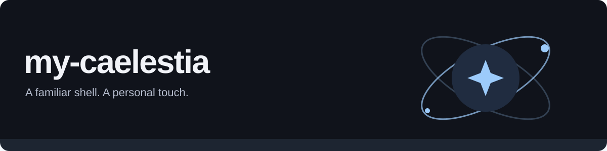

# my-caelestia

My personal fork of [Caelestia Shell](https://github.com/caelestia-dots/shell), with a local AI panel, display controls and a reproducible desktop setup.

[Install & update](GUIDE.md) · [Personal configuration](personal/) · [Upstream](https://github.com/caelestia-dots/shell) · [License](LICENSE)

## At a glance

- **Make it yours.** Display settings, live Wallpaper Engine backgrounds and personal Hyprland configuration.
- **A little extra.** Local Ollama chat, a playable sidebar Dino and a Codex terminal launcher.
- **Keep it together.** Matched QML and C++ plugin releases, update checks and a previous-release rollback.

## Get started

For **Arch Linux / CachyOS**. Download the bootstrap script and preview its plan:

```sh
curl -fsSL https://raw.githubusercontent.com/0Inexis0/my-caelestia/main/personal/bootstrap.sh -o /tmp/rice.sh
bash /tmp/rice.sh --dry-run
```

Run `bash /tmp/rice.sh` to install after reviewing the plan. Update with `rice-update`; see the [guide](GUIDE.md) for package updates, rollback and local edits.

> **Personal setup:** The installer changes packages and desktop configuration. Review it for your machine. The optional AI panel requires a local Ollama server and a downloaded model.

Built on [Caelestia](https://github.com/caelestia-dots). Upstream credits and licensing remain in the [guide](GUIDE.md) and [LICENSE](LICENSE).
